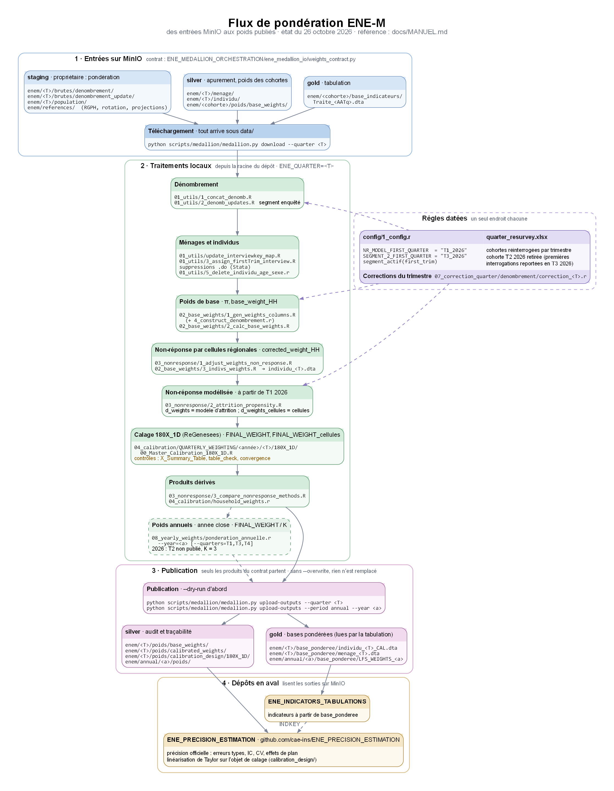

# RUWTHS : R Unified Weighting Treatment Harmonized System

**RUWTHS** *(prononcé « Ruth's »)* calcule les pondérations de l'Enquête Nationale sur l'Emploi auprès des Ménages (ENE-M, Côte d'Ivoire, ANStat) : poids de base, correction de la non-réponse, calage sur les totaux de population, poids ménages, poids annuels et, en cours de développement, poids longitudinaux. Le code est en R (calage avec **ReGenesees**), avec quelques fichiers Stata et un lanceur Python pour les échanges MinIO.

**Documentation de référence : [`docs/MANUEL.md`](docs/MANUEL.md)** (méthode, formules, fichiers, historique des choix, risques). Elle fait foi quand elle diverge des anciens documents (`docs/00_index.md` à `05_processus_complet.md`, `ARCHITECTURE_ENE_PIPELINE.md`).

## Principe

**Données, code et calcul sont indépendants.** Le code ne contient aucun chemin propre à un poste : `config/1_config.r` prend la racine du dépôt (répertoire de travail, ou `ENE_BASE_DIR`). Toutes les entrées se téléchargent depuis MinIO dans `data/` (non versionné), et tous les produits sont publiés sur MinIO. La liste des échanges est écrite dans le dépôt voisin [ENE_MEDALLION_ORCHESTRATION](https://github.com/cae-ins/ene_medallion_orchestration) (`ene_medallion_io/weights_contract.py`). Les dépôts ne s'échangent jamais de fichiers directement.

## Chaîne de traitement



Source modifiable : `reports/enem_weight_flow_minio.dot` (`dot -Tpng` et `dot -Tsvg`).

Ordre réel d'exécution (la numérotation des dossiers ne le reflète pas ; détail au §3.1 du manuel) :

| Étape | Script | Rôle |
|---|---|---|
| Entrées | `python scripts/medallion/medallion.py download --quarter <T>` | Télécharge références, dénombrements, fichiers apurés, entrées des cohortes |
| Dénombrement | `01_utils/1_concat_denomb.R`, `01_utils/2_denomb_updates.R` | Empile le dénombrement, intègre les dénombrements refaits sur le terrain |
| Ménages | `01_utils/update_interviewkey_map.R`, `3_assign_firstTrim_interview.R`, suppressions `.do`, `5_delete_individu_age_sexe.r` | Correspondance des entretiens, premier trimestre, nettoyage |
| Poids de base | `02_base_weights/1_gen_weights_columns.R`, `2_calc_base_weights.R` | Comptages par ZD, probabilités d'inclusion, `base_weight_HH` |
| Non-réponse | `03_nonresponse/1_adjust_weights_non_response.R`, puis `02_base_weights/3_indivs_weights.R` | Cellules régionales (`corrected_weight_HH`), fichiers ménages et individus |
| Non-réponse modélisée | `03_nonresponse/2_attrition_propensity.R` (à partir de T1 2026) | Modèle d'attrition : `d_weights` ; l'ancienne méthode reste dans `d_weights_cellules` |
| Calage | `04_calibration/QUARTERLY_WEIGHTING/<année>/<T>/180X_1D/00_Master_Calibration_180X_1D.R` | `FINAL_WEIGHT` (et `FINAL_WEIGHT_cellules` à partir de T1 2026) |
| Contrôles | `03_nonresponse/3_compare_nonresponse_methods.R`, `04_calibration/household_weights.r` | Comparaison des méthodes, poids ménages |
| Publication | `python scripts/medallion/medallion.py upload-outputs --quarter <T>` | `silver/enem/<T>/poids/`, `gold/enem/<T>/base_ponderee/` |
| Année | `08_yearly_weights/ponderation_annuelle.r --year=<a>` | `FINAL_WEIGHT / K` (`--quarters=` pour une année incomplète) |

Tous les scripts se lancent depuis la racine du dépôt. Le trimestre se fixe par `ENE_QUARTER=TX_AAAA` (ou `TARGET_QUARTER` dans `config/1_config.r`). Le pas-à-pas complet d'un trimestre est au §13.2 du manuel.

## Règles qui changent dans le temps

Elles sont centralisées, pour qu'un écart de terrain se traite à un seul endroit :

| Règle | Où | État |
|---|---|---|
| Méthode de non-réponse | `NR_MODEL_FIRST_QUARTER` (`config/1_config.r`) | Modélisée à partir de T1 2026 |
| Segment enquêté dans la ZD | `SEGMENT_2_FIRST_QUARTER`, `segment_actif()` (`config/1_config.r`) | Segment 2 pour les ZD dénombrées à partir de T3 2026, segment 1 avant |
| Calendrier de rotation | `data/01_raw/Organisation/quarter_resurvey.xlsx` (MinIO : `staging/enem/references/organisation/`) | Cohorte T2 2026 retirée : ses premières interrogations ont été reportées en T3 2026 |
| Corrections propres à un trimestre | `scripts/07_correction_quarter/denombrement/correction_<T>.r` | Chargées automatiquement par `4_construct_denombrement.r` |

T2 2026 (réinterrogations seules, par téléphone) est traité pour la continuité des échantillons, mais **n'est pas publié**. Les poids annuels 2026 se calculent avec `--quarters=T1,T3,T4`.

## Échanges MinIO

```bash
python scripts/medallion/medallion.py download        --quarter T3_2026 [--dry-run] [--overwrite]
python scripts/medallion/medallion.py upload-inputs   --quarter T3_2026 [--references] [--all-quarters]
python scripts/medallion/medallion.py upload-outputs  --quarter T3_2026 [--dry-run] [--overwrite]
python scripts/medallion/medallion.py upload-outputs  --period annual --year 2025
```

- Lancer `--dry-run` avant un envoi réel pour voir la liste exacte des objets et des destinations. Sans `--overwrite`, un objet existant n'est jamais remplacé.
- Seuls les produits listés dans le contrat de données partent ; les fichiers d'essai laissés dans `data/` ne sont jamais publiés.
- Les identifiants vivent uniquement dans `.env` (modèle : `.env.example`) ou dans le fichier de secrets du module d'orchestration. Ne jamais les copier dans un fichier versionné.
- Le lanceur ajoute l'hôte MinIO à `NO_PROXY` et cherche le dépôt `ENE_MEDALLION_ORCHESTRATION` à côté de celui-ci, ou dans `ENE_ORCHESTRATION_ROOT`. Hors du réseau ANStat, les publications attendent : le circuit ne change pas.

Buckets et préfixes : manuel, §11.

## Structure du dépôt

```
config/          1_config.r (racine, trimestre, règles datées), dictionnaire des variables, configuration des poids longitudinaux
data/            entrées et produits, reconstruits depuis MinIO (non versionné)
docs/            MANUEL.md (référence) ; anciens documents
scripts/
  00_setup/                installation des paquets (ReGenesees depuis GitHub)
  01_utils/                dénombrement, correspondance des entretiens, nettoyage, totaux, RGPH
  02_base_weights/         comptages par ZD, probabilités d'inclusion, poids de base, fichiers individus
  03_nonresponse/          cellules régionales, modèle d'attrition, comparaison
  04_calibration/          calage par trimestre (QUARTERLY_WEIGHTING/<année>/<T>/180X_1D/), poids ménages
  05_quality_control/      qualité des estimations (CV)
  07_correction_quarter/   corrections propres à chaque trimestre
  08_yearly_weights/       poids annuels
  11_modif_design/         simulation de réduction d'échantillon
  12_longitudinal_weights/ probabilités de retour et poids longitudinaux (en cours)
  medallion/               lanceur MinIO (Python)
dashboard/       tableaux de bord Shiny de suivi des incohérences
reports/         schémas et graphiques
tests/           tests testthat
```

## Prérequis

- R ≥ 4.4 ; paquets : `scripts/00_setup/install_required_packages.R` ; ReGenesees depuis GitHub (`DiegoZardetto/ReGenesees`).
- Python avec `boto3`, et le dépôt `ENE_MEDALLION_ORCHESTRATION`.
- Stata pour les fichiers de suppression `.do`.

## Précision des estimations

**La précision officielle (erreurs types, intervalles de confiance, CV, effets de plan), calculée avec les formules qui tiennent compte du plan de sondage, du calage et de la rotation, se trouve dans le dépôt [cae-ins/ENE_PRECISION_ESTIMATION](https://github.com/cae-ins/ENE_PRECISION_ESTIMATION).** Il lit l'objet de calage que ce dépôt publie dans `silver/enem/<T>/poids/calibration_design/180X_1D/`, et la base d'indicateurs de [ENE_INDICATORS_TABULATIONS](https://github.com/cae-ins/ene_indicators_tabulations). Sa méthode est décrite dans `docs/NOTE_METHODOLOGIQUE_PRECISION_ENE.md`.

## Contrôle qualité

- Calage : `X_Summary_Table` (aucune « Error », `Diff_Known_Tot_Final_Est` = 0, facteur de correction dans [0,95 ; 1,65], cellules ≥ 30), `table_check` (écart ≤ 100), statut de convergence `ecal.status.production`.
- `05_quality_control/postestimation_quality.R` classe les estimations A (CV < 15 %), B (15–30 %), C (≥ 30 %) pour un contrôle rapide ; ses erreurs types ignorent le plan de sondage. Pour les chiffres publiés, utiliser [ENE_PRECISION_ESTIMATION](https://github.com/cae-ins/ENE_PRECISION_ESTIMATION).
